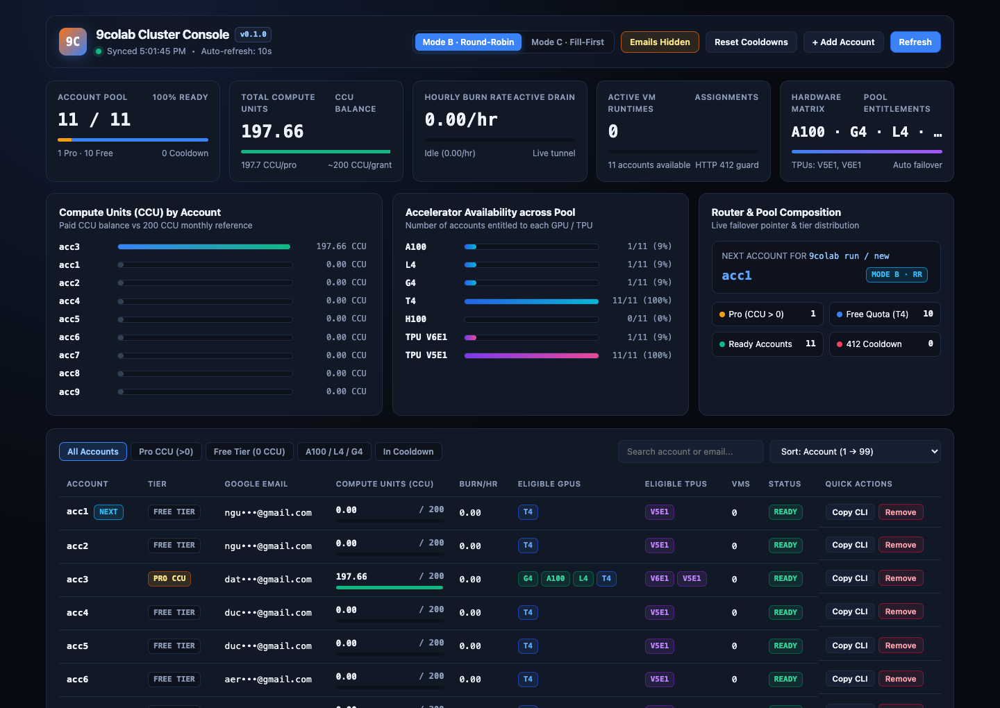
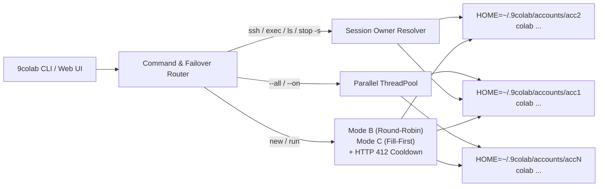

<div align="center">

# 9colab

**Multi-Account GPU Pool Controller, Automatic Failover Router, and Cluster Dashboard for Google Colab CLI**

[](https://www.python.org/)
[](#installation)
[](#command-reference)
[](LICENSE)

<p align="center">
  <a href="#why-9colab">Why 9colab?</a> &bull;
  <a href="#installation">Installation</a> &bull;
  <a href="#quick-start">Quick Start</a> &bull;
  <a href="#web-dashboard">Web Dashboard</a> &bull;
  <a href="#selection-modes--failover">Failover Modes</a> &bull;
  <a href="#command-reference">Commands</a>
</p>



</div>

---

## Why 9colab?

[`google-colab-cli`](https://github.com/googlecolab/google-colab-cli) lets you run scripts and SSH into Google Colab VMs from your terminal. However, it stores a single OAuth token at `~/.config/colab-cli/token.json`. You cannot log in multiple Google accounts or fail over when one account hits a quota limit.

**9colab** turns multiple Google Colab and Google AI Pro accounts into one unified GPU/TPU pool:

| Capability | `google-colab-cli` (`colab`) | `9colab` |
|---|---|---|
| **Accounts supported** | 1 account (`~/.config/colab-cli/token.json`) | Unlimited isolated accounts (`~/.9colab/accounts/<name>/`) |
| **Hardware visibility** | Shows `currentBalance` only (`colab usage`) | Shows `currentBalance`, burn rate, `eligibleGpus` (`A100`, `L4`, `G4`, `T4`, `H100`), and `eligibleTpus` (`V6E1`, `V5E1`) |
| **Account selection** | Manual re-login | **Mode B** (`round-robin`, default) and **Mode C** (`fill-first`) |
| **HTTP 412 quota refusal** | Exits with error | Places account in cooldown and fails over to the next account |
| **Session routing (`-s`)** | Current account only | Scans all profiles and attaches TTY (`ssh`, `repl`, `console`, `edit`) to the owner account |
| **Parallel execution** | No | Run across all accounts (`--all`) or specific accounts (`--on acc1,acc2`) |
| **Web telemetry UI** | No | Built-in dark cluster console (`9colab`) with CCU bars, GPU matrix, and OAuth wizard |
| **Runtime dependencies** | `typer`, `requests`, `pydantic`, ... | **0 external dependencies** (Python standard library only) |

---

## Architecture



---

## Installation

### Prerequisites

Install [`google-colab-cli`](https://github.com/googlecolab/google-colab-cli) with [`uv`](https://docs.astral.sh/uv/) or `pipx`:

```bash
uv tool install google-colab-cli
```

### Install 9colab

```bash
git clone https://github.com/nguyenanhducdeveloper86/9colabs.git
cd 9colabs
uv tool install .
```

Ensure `~/.local/bin` is in your `PATH`:

```bash
export PATH="$HOME/.local/bin:$PATH"
```

---

## Quick Start

### 1. Import Your Existing Colab Login or Add New Accounts

Import an existing `~/.config/colab-cli` login in one command:

```bash
9colab import
```

Add more Google Colab or Google AI Pro accounts. Omit the name to auto-number (`acc2`, `acc3`, ...), or pass a custom alias:

```bash
9colab add
9colab add pro-main
```

> **Note:** Each `9colab add` call generates a new OAuth2 URL with a fresh PKCE verifier. Always open the latest URL printed in your terminal and paste the code from that page.

### 2. Launch the Web Cluster Console

Run `9colab` with no arguments. It starts a local server on `127.0.0.1:8765` (or the next free port) and opens your browser:

```bash
9colab
```

### 3. Inspect All Accounts in the Terminal

```bash
9colab list
```

```text
Selection mode: B (round-robin)
ACCOUNT      EMAIL                                 UNITS  RATE/HR SESSIONS GPUS           TPUS       STATUS
-----------------------------------------------------------------------------------------------------------
acc1         user1@gmail.com                        0.00     0.00        0 T4             V5E1       READY
acc2         user2@gmail.com                        0.00     0.00        0 T4             V5E1       READY
acc3         user3@gmail.com                      197.66     0.00        0 G4,A100,L4,T4  V6E1,V5E1  READY
-----------------------------------------------------------------------------------------------------------
Total accounts: 3 | Total compute units: 197.66 | Active sessions: 0
```

### 4. Run Scripts and Create Sessions with Automatic Failover

```bash
# Run a script on the next eligible account (fails over on HTTP 412 / GPU entitlement refusal)
9colab run train.py --gpu T4

# Request an A100 GPU (automatically skips T4-only accounts and lands on an A100-eligible account)
9colab run finetune.py --gpu A100

# Create a persistent session
9colab new --gpu T4 -s exp-1
```

### 5. Control Live Sessions Without Tracking Accounts

`9colab` locates the account that owns `-s <session>` automatically:

```bash
9colab sessions
9colab exec -s exp-1 "nvidia-smi"
9colab upload -s exp-1 ./data.parquet /content/data.parquet
9colab ssh -s exp-1
9colab stop -s exp-1
```

### 6. Run Jobs in Parallel Across Multiple Accounts

```bash
# Run a script on all accounts at the same time
9colab run sweep.py --gpu T4 --all

# Run a shell or Python snippet on selected accounts
9colab exec "nvidia-smi" --on acc1,acc2,acc3

# Stop all active sessions across every account
9colab stop --all
```

---

## Web Dashboard

Start the dashboard with `9colab` or `9colab ui [--port 8765] [--no-open]`.

- **5 Live KPI Cards**: Pool readiness, total CCU balance, hourly burn rate with remaining runtime estimate, active VM assignments, and hardware matrix.
- **3 Telemetry Charts**:
  1. **Compute Units by Account**: Horizontal bars comparing each account against the 200 CCU monthly grant.
  2. **Accelerator Availability**: Percentage and count of accounts eligible for `A100`, `L4`, `G4`, `T4`, `H100`, `TPU V6E1`, and `TPU V5E1`.
  3. **Router & Pool Composition**: Live pointer showing which account will take the next `9colab run` / `9colab new` job.
- **Filter Tabs, Search, and Natural Sorting**: Filter by `All`, `Pro CCU (>0)`, `Free Tier`, `A100 / L4 / G4`, or `In Cooldown`. Sort naturally (`acc1, acc2, ..., acc11`) or by CCU balance.
- **Privacy Mode (`Hide Emails` / `?mask=1`)**: One click masks email addresses (`ngu•••@gmail.com`) so you can share screenshots safely.
- **Local-Only Security Guard**: Binds strictly to `127.0.0.1`, blocks foreign `Host` headers, and rejects non-JSON `POST` requests to prevent cross-site form attacks.

---

## Selection Modes & Failover

Switch between **Mode B** and **Mode C** from the Web UI or terminal:

```bash
# Mode B (default): Rotate across accounts in order (Round-Robin)
9colab mode B

# Mode C: Keep using one account until Colab refuses allocation, then advance (Fill-First)
9colab mode C
```

### How Failover Works

1. `9colab` orders candidate accounts according to the active mode (`B` or `C`) and skips accounts in cooldown.
2. It runs `colab new` or `colab run` on the first candidate.
3. If Colab returns HTTP 412 (`Allocation refused (precondition failed)`) or HTTP 400 (`Backend rejected accelerator`), `9colab` places that account in cooldown (default: 60 minutes) and immediately tries the next account.
4. If the VM starts and your Python script itself raises an error, `9colab` exits with your script's error code and **does not** re-run the broken script on another account.

---

## Command Reference

| Group | Command | Action |
|---|---|---|
| **Web Console** | `9colab` / `9colab ui [--port N] [--no-open]` | Start the local web dashboard. |
| **Account Pool** | `9colab add [name]` | Log in a new Google account via OAuth2 (auto-names `acc1`, `acc2`, ...). |
| | `9colab import [name]` | Import `~/.config/colab-cli` into `[name]`. |
| | `9colab list` / `9colab usage` | Print parallel table of email, CCU, burn rate, GPUs, TPUs, and status. |
| | `9colab mode [B\|C\|round-robin\|fill-first]` | Get or set the router selection strategy. |
| | `9colab account rm <name>` | Remove a saved account profile. |
| | `9colab account clear-cooldown [name]` | Reset cooldown timer for one or all accounts. |
| **VM Creation** | `9colab new [--gpu X] [-s NAME]` | Allocate a new Colab session with automatic failover. |
| | `9colab run SCRIPT [--gpu X]` | Run a Python script on a fresh VM with automatic failover. |
| **Pool Views** | `9colab sessions` | List active sessions across all accounts. |
| | `9colab whoami` | List all account aliases and Google email addresses. |
| **Session Control** | `9colab exec\|repl\|console -s NAME` | Execute code, start an interactive REPL, or attach to the TTY console. |
| | `9colab ssh\|url\|status\|stop -s NAME` | Open SSH, print browser URL, inspect status, or terminate a VM. |
| | `9colab ls\|upload\|download\|edit\|rm -s NAME` | List, transfer, edit, or delete files on the remote runtime. |
| | `9colab install\|drivemount\|auth\|log -s NAME` | Install packages, mount Google Drive, authenticate GCP, or export logs. |
| **Passthrough** | `9colab pay\|readme\|skill\|update\|version` | Forward directly to `colab`. |

---

## Security & Storage

- Account profiles live outside the repository at `~/.9colab/accounts/<name>/` with `0700` directory permissions and `0600` token permissions.
- Set `NINECOLAB_HOME=/custom/path` to customize the storage path.

---

## Contributing

Issues and pull requests are welcome at [github.com/nguyenanhducdeveloper86/9colabs](https://github.com/nguyenanhducdeveloper86/9colabs).

1. Fork the repository and create a feature branch.
2. Test your changes locally with `uv tool install --force .`.
3. Submit a pull request.
---

## License

Released under the [MIT License](LICENSE).
