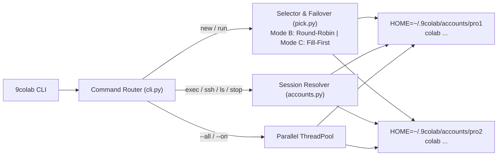

# 9colab

[](https://www.python.org/)
[](#installation)
[](LICENSE)
[](https://github.com/googlecolab/google-colab-cli)

**9colab** is a multi-account controller, quota failover router, and parallel job runner for [`google-colab-cli`](https://github.com/googlecolab/google-colab-cli).

Pool multiple Google Colab or Google AI Pro accounts into one CLI. Inspect eligible GPUs (`T4`, `L4`, `A100`, `H100`) and TPUs across all accounts in one table. Route `new` and `run` jobs automatically with Round-Robin (**Mode B**) or Fill-First (**Mode C**) selection. Fail over to the next account when Google returns HTTP 412 (`Allocation refused`).

---

## Key Features

- **Zero-Patch Account Isolation**: Isolates each Google account in `~/.9colab/accounts/<name>/` (mode `0700`). Token, `sessions.json`, history, and logs never collide.
- **Full `ccu-info` Visibility**: Displays real-time compute units, hourly burn rate, active sessions, `eligibleGpus`, and `eligibleTpus` across all accounts in parallel. Even when `currentBalance` is `0.00`, `9colab list` shows whether an account can still allocate `T4` or `V5E1` runtimes.
- **Two Selection Modes**:
  - **Mode B (`round-robin`, default)**: Rotates new jobs across ready accounts.
  - **Mode C (`fill-first`)**: Uses one account until Colab refuses allocation, then moves to the next account.
- **Automatic Quota Failover**: Detects HTTP 412 (`Allocation refused`) and HTTP 400 (`Backend rejected accelerator`) during VM creation. Places the exhausted account in cooldown and retries on the next account. User script errors never trigger duplicate retries.
- **100% `google-colab-cli` Parity**: Supports all 26 `colab` commands (`new`, `run`, `exec`, `ssh`, `repl`, `console`, `ls`, `upload`, `download`, `edit`, `rm`, `install`, `drivemount`, `auth`, `sessions`, `status`, `stop`, `restart-kernel`, `log`, `url`, `usage`, `whoami`, `pay`, `readme`, `skill`, `update`, `version`).
- **Automatic Session Ownership Lookup**: Finds which account owns `-s <session>` and uses `os.execvpe` so interactive TTY commands (`ssh`, `repl`, `console`, `edit`) work natively.
- **Parallel Multi-Account Execution**: Run a script or command across all accounts (`--all`) or selected accounts (`--on acc1,acc2`) at the same time.
- **Zero External Dependencies**: Uses the Python standard library only.

---

## Architecture



---

## Installation

1. Install [`google-colab-cli`](https://github.com/googlecolab/google-colab-cli) first:

```bash
uv tool install google-colab-cli
```

2. Install `9colab`:

```bash
git clone https://github.com/nguyenanhducdeveloper86/9colabs.git
cd 9colabs
uv tool install .
```

Make sure `~/.local/bin` is in your `PATH`:

```bash
export PATH="$HOME/.local/bin:$PATH"
```

---

## Quick Start

### 1. Import an Existing Login or Add New Accounts

If you already logged in with `colab`, import that session as your first account:

```bash
9colab import pro1
```

Log in additional Google Colab / AI Pro accounts:

```bash
9colab add pro2
9colab add pro3
```

> **Note:** Each `9colab add` call generates a new OAuth2 URL with a unique PKCE code verifier. Always open the latest URL printed in the terminal and paste the code from that URL.

### 2. Inspect All Accounts at Once

```bash
9colab list
```

Example output:

```text
Selection mode: B (round-robin)
ACCOUNT      EMAIL                             UNITS  RATE/HR SESSIONS GPUS           TPUS       STATUS
------------------------------------------------------------------------------------------------------
pro1         user1@gmail.com                    0.00     0.00        0 T4             V5E1       READY
pro2         user2@gmail.com                  100.00     0.00        0 T4,L4,A100     V5E1,V6E1  READY
pro3         user3@gmail.com                    0.00     0.00        1 T4             V5E1       READY
------------------------------------------------------------------------------------------------------
Total accounts: 3 | Total compute units: 100.00 | Active sessions: 1
```

### 3. Switch Between Selection Mode B and Mode C

```bash
# Mode B (default): Rotate across accounts (Round-Robin)
9colab mode B
# or: 9colab mode round-robin

# Mode C: Drain one account until HTTP 412 refusal, then switch (Fill-First)
9colab mode C
# or: 9colab mode fill-first
```

### 4. Run Jobs with Automatic Failover

```bash
# Picks an account automatically and fails over on HTTP 412 quota errors
9colab run train.py --gpu T4

# Create a persistent session on the next available account
9colab new --gpu T4 -s exp1
```

### 5. Control Live Sessions Across Accounts

You do not need to remember which account owns a session. `9colab` scans all profiles and routes the command to the owner account:

```bash
9colab sessions
9colab exec -s exp1 "nvidia-smi"
9colab upload -s exp1 ./dataset.zip /content/dataset.zip
9colab ssh -s exp1
9colab stop -s exp1
```

### 6. Run Jobs in Parallel Across Multiple Accounts

```bash
# Run a script on all accounts simultaneously
9colab run benchmark.py --gpu T4 --all

# Run a command on specific accounts simultaneously
9colab exec "nvidia-smi" --on pro1,pro2

# Stop all active sessions across all accounts
9colab stop --all
```

---

## Command Reference

| Category | Command | Description |
|---|---|---|
| **Account Management** | `9colab add <name>` | Authorize and save a new Google account profile. |
| | `9colab import <name>` | Copy `~/.config/colab-cli` into account `<name>`. |
| | `9colab list` / `9colab usage` | Display compute units, GPUs, TPUs, and status across all accounts. |
| | `9colab mode [B\|C\|round-robin\|fill-first]` | Show or change the account selection strategy. |
| | `9colab account rm <name>` | Delete a saved account profile. |
| | `9colab account clear-cooldown [name]` | Clear the HTTP 412 cooldown timer for one or all accounts. |
| **Runtime Creation** | `9colab new [--gpu X] [-s NAME]` | Create a persistent Colab VM with automatic failover. |
| | `9colab run SCRIPT [--gpu X]` | Run a Python script on a fresh Colab VM with automatic failover. |
| **Multi-Account Views** | `9colab sessions` | List active sessions across all accounts. |
| | `9colab whoami` | List account names and Google email addresses. |
| **Session Operations** | `9colab exec\|repl\|console -s NAME` | Execute code, open a REPL, or attach to the raw TTY console. |
| | `9colab ssh\|url\|status\|stop -s NAME` | Connect via SSH, print browser URL, check status, or stop a VM. |
| | `9colab ls\|upload\|download\|edit\|rm -s NAME` | Manage files on the remote Colab VM. |
| | `9colab install\|drivemount\|auth\|log -s NAME` | Install packages, mount Google Drive, authenticate GCP, or view logs. |
| **Global Passthrough** | `9colab pay\|readme\|skill\|update\|version` | Forward directly to `colab`. |

---

## Security & Storage

- All account credentials live outside the repository in `~/.9colab/accounts/<name>/` with `0700` directory permissions and `0600` token permissions.
- Set `NINECOLAB_HOME=/custom/path` to relocate the storage directory.
- Run the offline test suite at any time:

```bash
PYTHONPATH=src python3 -m unittest discover -s tests -v
```

---

## License

Released under the [MIT License](LICENSE).
